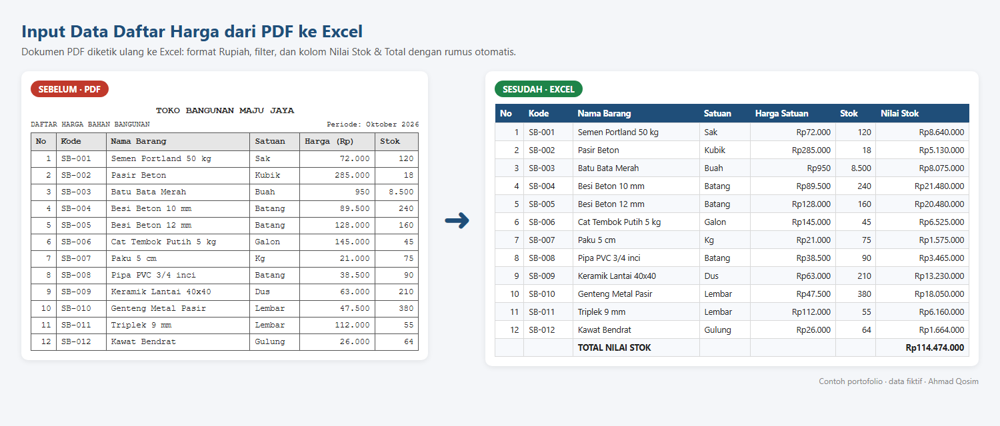
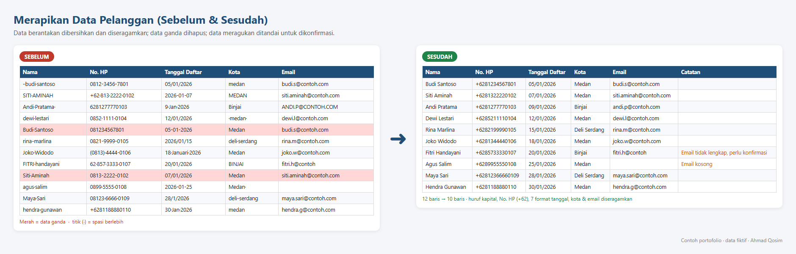
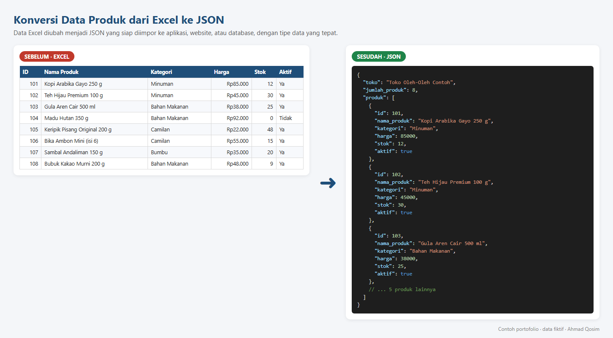

# Portofolio Data Entry & Konversi Data

Contoh hasil kerja **Ahmad Qosim**: input data dari PDF ke Excel, merapikan data, dan konversi data ke JSON.

> Semua data di repository ini **fiktif** dan dibuat khusus sebagai contoh portofolio.

---

## 1. Input Data Daftar Harga dari PDF ke Excel

Mengetik ulang daftar harga 12 produk dari dokumen PDF ke Excel. Hasilnya rapi dan siap dipakai: format Rupiah, filter per kolom, header tetap terlihat saat di-scroll, serta kolom **Nilai Stok** dan **Total** yang dihitung otomatis dengan rumus.

| File | Keterangan |
|---|---|
| [`sumber_daftar_harga.pdf`](1_PDF_ke_Excel/sumber_daftar_harga.pdf) | Dokumen sumber |
| [`hasil_daftar_harga.xlsx`](1_PDF_ke_Excel/hasil_daftar_harga.xlsx) | Hasil di Excel |

---

## 2. Merapikan Data Pelanggan (Sebelum & Sesudah)

Membersihkan 12 baris data pelanggan:

- Menyeragamkan huruf kapital nama
- Menyeragamkan format nomor HP menjadi `+62`
- Mengubah 7 format tanggal berbeda menjadi satu format
- Menyeragamkan penulisan kota dan email
- Menghapus 2 data ganda (12 baris menjadi 10 baris)
- Menandai data yang meragukan untuk dikonfirmasi, bukan mengubahnya sembarangan

| File | Keterangan |
|---|---|
| [`merapikan_data_pelanggan.xlsx`](2_Merapikan_Data/merapikan_data_pelanggan.xlsx) | Sheet **Sebelum**, **Sesudah**, dan **Catatan Perubahan** |

---

## 3. Konversi Data Produk dari Excel ke JSON

Mengubah data 8 produk dari Excel menjadi format JSON yang siap diimpor ke aplikasi, website, atau database. Tipe data disesuaikan: harga dan stok sebagai angka, status aktif sebagai `true`/`false`.

| File | Keterangan |
|---|---|
| [`data_produk.xlsx`](3_Excel_ke_JSON/data_produk.xlsx) | Data sumber di Excel |
| [`data_produk.json`](3_Excel_ke_JSON/data_produk.json) | Hasil konversi JSON |

---

## Jasa yang saya tawarkan

- Input data dari PDF, scan, atau foto ke Excel, Google Sheets, atau Word
- Konversi data ke format JSON, CSV, atau SQL
- Merapikan dan membersihkan data
- Rumus dan rekap sederhana di Excel
- Pelabelan data dan anotasi teks bahasa Indonesia

**Kontak:** [LinkedIn](https://www.linkedin.com/in/ahmad-qosim-064280438)
